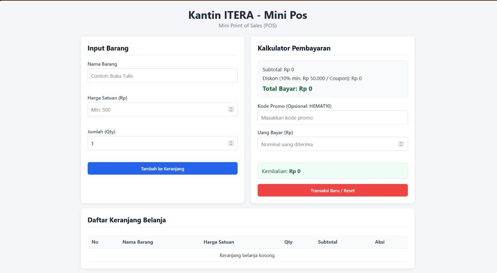
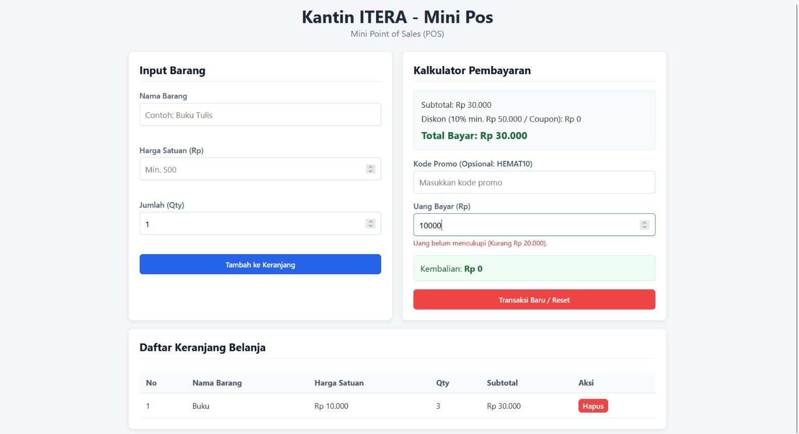
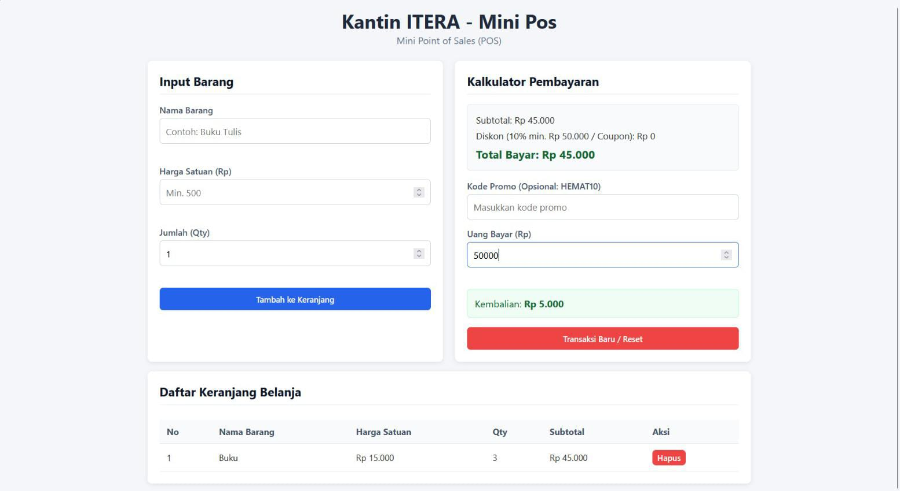

# Tugas Praktikum Pemrograman Web - Pertemuan 1
## Aplikasi Kasir & Keranjang Belanja Sederhana (Mini POS)

### Identitas
- **Nama Lengkap:** Amelinda Simanjuntak
- **NIM:** 124140038
- **Kelas Praktikum:** RA

---

### Deskripsi Aplikasi
Aplikasi **Mini POS (Point of Sales)** ini dirancang untuk mempermudah pencatatan dan kalkulasi transaksi pada kantin atau toko kampus. Aplikasi ini mengintegrasikan validasi input interaktif, perhitungan kalkulator diskon serta kembalian secara otomatis, dan manajemen keranjang belanja berbasis `localStorage` agar data transaksi tetap aman meskipun browser di-refresh.

---

### Panduan Menjalankan Aplikasi
1. Clone atau unduh repository ini ke komputer lokal Anda.
2. Buka folder `Amelinda Simanjuntak_124140038_Pertemuan1` menggunakan editor kode **VS Code**.
3. Pastikan ekstensi **Live Server** di VS Code sudah terpasang.
4. Klik kanan pada file `index.html` lalu pilih **Open with Live Server**.
5. Aplikasi akan terbuka secara otomatis di browser pada URL default `http://127.0.0.1:5500`.

---

### Daftar Fitur Utama
- [x] **Validasi Form Input:**
  - Nama barang minimal 3 karakter.
  - Harga satuan berupa angka minimal Rp 500.
  - Jumlah (Qty) minimal 1.
  - Tampilan pesan error merah di bawah input jika data tidak sesuai.
- [x] **Kalkulator Otomatis:**
  - Kalkulasi subtotal per barang ($harga \times qty$).
  - Perhitungan akumulasi total keranjang.
  - Diskon otomatis 10% jika total belanja $\ge$ Rp 50.000 atau menggunakan kode promo `HEMAT10`.
  - Perhitungan uang kembalian dan penanganan ketergantungan jika uang bayar kurang.
- [x] **Manajemen Keranjang & LocalStorage:**
  - Tabel belanja dinamis.
  - Tombol hapus item interaktif.
  - Persistensi data keranjang menggunakan `JSON.stringify()` dan `JSON.parse()`.
  - Tombol reset/transaksi baru untuk membersihkan keranjang dan `localStorage`.

---

### Tangkapan Layar (Screenshot)

1. **Tampilan Utama Aplikasi & Input Barang:**
   

2. **Tampilan Validasi Error pada Form Input:**
   

3. **Tampilan Kalkulator & Tabel Keranjang Belanja:**
   

---

### Penjelasan Teknis
1. **Penanganan Validasi Input:**
   Validasi ditangani pada fungsi `validasiForm()` sebelum data dimasukkan ke array state. Jika elemen input tidak memenuhi kriteria, pesan error akan dituliskankan ke tag `<small class="error-text">` dan fungsi mengembalikan nilai `false` untuk mencegah eksekusi form submit.

2. **Algoritma Kalkulator Keuangan:**
   Setiap kali ada perubahan pada keranjang atau input pembayaran, fungsi `hitungKalkulator()` dieksekusi. Fungsi ini memanfatkan metode `.reduce()` untuk menjumlahkan total belanja, mengecek syarat diskon 10%, dan menghitung selisih uang bayar terhadap total akhir.

3. **Mekanisme Serialisasi LocalStorage:**
   Array objek `keranjang` diubah menjadi string JSON melalui `JSON.stringify()` saat terjadi penambahan atau penghapusan item. Ketika halaman dimuat ulang, data dibaca kembali melalui `JSON.parse(localStorage.getItem('mini_pos_keranjang'))`.