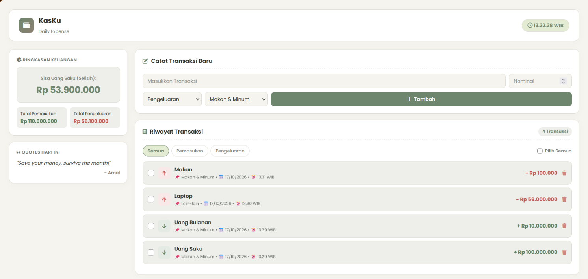

# KasKu - Pencatat Keuangan Mahasiswa
> **Tugas Praktikum Pemrograman Web / JavaScript Modern**  
> **Aplikasi:** Financial Dashboard & Daily Expense 

---

## 1. Penjelasan Singkat Aplikasi & Fitur
**KasKu** adalah aplikasi *personal dashboard* keuangan interaktif berbasis Single Page Application (SPA) yang dirancang khusus untuk membantu mahasiswa mengelola uang saku, mencatat pengeluaran harian (seperti makanan, perlengkapan kuliah, hingga tagihan kos), dan memperhitungkan selisih saldo secara *real-time*. Aplikasi ini hadir dengan antarmuka bertema *Soft Natural Earth Tone (Sage & Warm Beige)* yang estetik, modern, dan nyaman digunakan.

### Fitur Utama:
* **Pengelolaan Transaksi (CRUD Lengkap):** Menambah Pemasukan/Pengeluaran dengan penanggalan & jam pencatatan otomatis (`⏰ HH:MM WIB`), filter kategori transaksi, serta pencarian riwayat yang rapi.
* **Fitur Hapus Pilihan (Multiple / Batch Delete):** Memungkinkan pengguna memilih/mencentang beberapa transaksi sekaligus menggunakan *checkbox* dan menghapusnya secara bersamaan.
* **Custom Modal Pop-up Estetik:** Konfirmasi penghapusan data menggunakan modal buatan sendiri dengan efek *glassmorphism blur* yang senada dengan tema aplikasi (bukan *alert/confirm* kaku bawaan browser).
* **Kalkulasi Selisih Saldo Otomatis:** Menghitung total sisa uang saku, total pemasukan, dan total pengeluaran secara *real-time* memanfaatkan method ES6+ `reduce()`.
* **Penyimpanan Lokal (`localStorage`):** Seluruh data transaksi tersimpan otomatis dan permanen di browser pengguna dengan *key* `kasku_budget_data`.
* **Integrasi API Publik (JSONPlaceholder):** Mengambil data transaksi simulasi awal secara asinkron menggunakan `async/await` dan `fetch()`.

---

## 2. Screenshot Antarmuka Aplikasi

| Tampilan Utama Financial Dashboard |
| :---: |
| |

---

## 3. Daftar Fitur ES6+ & Baris Kode (`script.js`)

| Fitur ES6+ | Deskripsi / Implementasi | Lokasi Baris di `script.js` |
| :--- | :--- | :--- |
| **1. `let` dan `const`** | Deklarasi variabel imun (`const`) dan variabel mutabel (`let`) secara tepat. | **Baris:** 9, 10, 21, 32, 101, 168, 184, dll. |
| **2. Arrow Functions (`() => {}`)** | Event handlers, method DOM initialization, iterator array (`map`, `filter`, `reduce`). | **Baris:** 36, 56, 62, 69, 117, 166, 181, dll. |
| **3. Template Literals** | Menyusun HTML dinamis untuk kartu transaksi dan kutipan motivasi. | **Baris:** 81, 187-203 |
| **4. Async / Await** | Pemanggilan API eksternal (`verifyPublicAPI`). | **Baris:** 110-118 |
| **5. Classes (OOP)** | Class `TransactionItem` (Model) dan Class `BudgetApp` (Controller/Core). | **Baris:** 8-18 (`TransactionItem`), 22-206 (`BudgetApp`) |
| **6. Destructuring** | Pembongkaran properti objek pada render transaksi. | **Baris:** 183 (`{ id, title, amount, type, category, date, time }`) |
| **7. Spread Operator (`...`)** | Menyalin dan menambahkan transaksi baru ke dalam array state tanpa merusak *immutability*. | **Baris:** 137 (`[newTrans, ...this.transactions]`) |

---

## 4. Panduan Menjalankan Aplikasi
1. Buka file `index.html` menggunakan browser modern (Google Chrome / Microsoft Edge).
2. Pastikan terhubung ke internet agar icon & font dapat dimuat secara lancar.