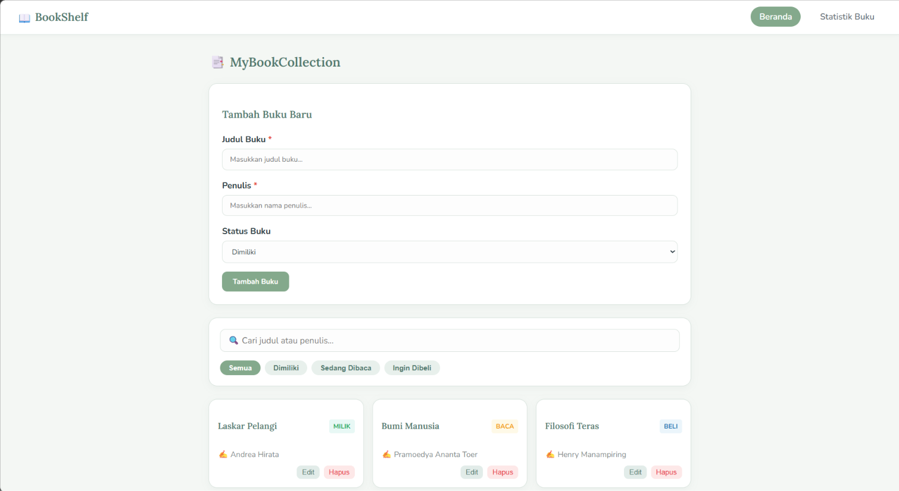
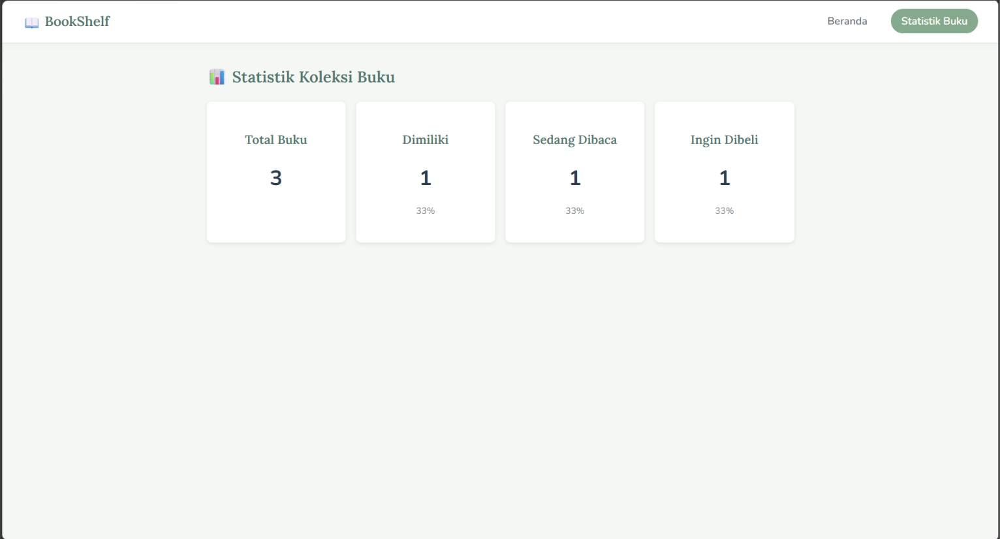
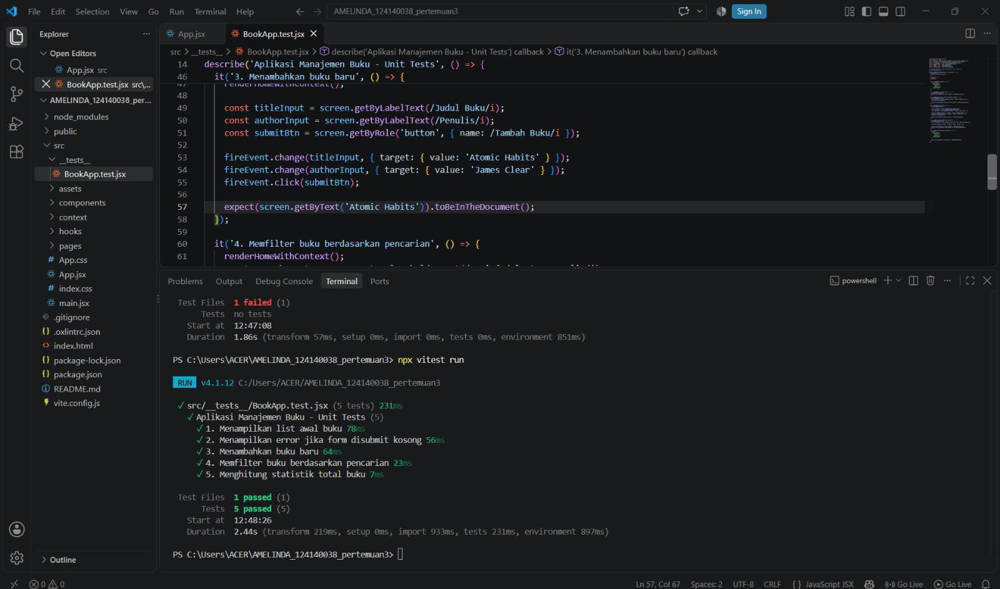

# 📖 BookShelf — MyBookCollection

Aplikasi web manajemen koleksi buku pribadi yang dibangun menggunakan React.js dengan antarmuka modern, responsif, dan bertema **Sage Dream**.

---

##  Deskripsi Aplikasi

**BookShelf — MyBookCollection** adalah platform digital untuk membantu pengguna mengelola, mencatat, dan memantau status buku bacaan mereka secara terorganisir. Aplikasi ini dilengkapi dengan statistik koleksi real-time, fungsionalidad penambahan/penghapusan buku, serta penyaringan (*filtering*) status buku.

---

##  Penjelasan Fitur React yang Digunakan

Aplikasi ini mengimplementasikan beberapa fitur dan konsep utama React:

- **JSX (JavaScript XML)**: Digunakan untuk menyusun struktur UI deklaratif secara fleksibel di dalam komponen React.
- **Components & Props**: Arsitektur komponen modular (seperti Navbar, Form, Card, dan Stats) untuk *reusability* dan pengiriman data antar-komponen.
- **useState Hook**: Mengelola *state* reaktif seperti daftar buku, status input form, dan filter kategori secara dinamis.
- **useEffect Hook**: Menangani *side effects* seperti penyimpanan data lokal (*LocalStorage*) dan sinkronisasi data saat komponen dirender.
- **Conditional Rendering**: Menampilkan elemen UI tertentu berdasarkan status data (misalnya: pesan saat koleksi kosong atau indikator statistik).
- **Event Handling**: Menangani interaksi pengguna seperti submit form, klik filter, dan aksi hapus buku.

---

##  Instruksi Instalasi & Cara Menjalankan Aplikasi

1. **Buka Project di VS Code**:
   - Buka aplikasi **Visual Studio Code**.
   - Pilih menu **File > Open Folder...** lalu pilih folder project ini.

2. **Buka Terminal VS Code**:
   - Tekan tombol `Ctrl + ~` (atau pilih **Terminal > New Terminal**).

3. **Install Dependensi**:
   - Jalankan perintah berikut untuk mengunduh seluruh *package* yang dibutuhkan:
     ```bash
     npm install
     ```

4. **Jalankan Aplikasi**:
   - Jalankan perintah berikut untuk mengaktifkan server pengembangan lokal:
     ```bash
     npm run dev
     ```
   - *Atau (jika menggunakan Create React App)*:
     ```bash
     npm start
     ```
   - Buka alamat URL yang tertera di terminal (contoh: `http://localhost:5173`) pada browser kamu.

---

##  Screenshot Antarmuka Aplikasi

Berikut adalah tampilan antarmuka aplikasi **BookShelf — MyBookCollection** dengan penerapan tema warna *Sage Dream*, serta komponen Navbar, Form Input, dan Statistik Koleksi Buku.





---

##  Laporan Testing

Berikut adalah hasil eksekusi *unit testing* aplikasi pada terminal:

