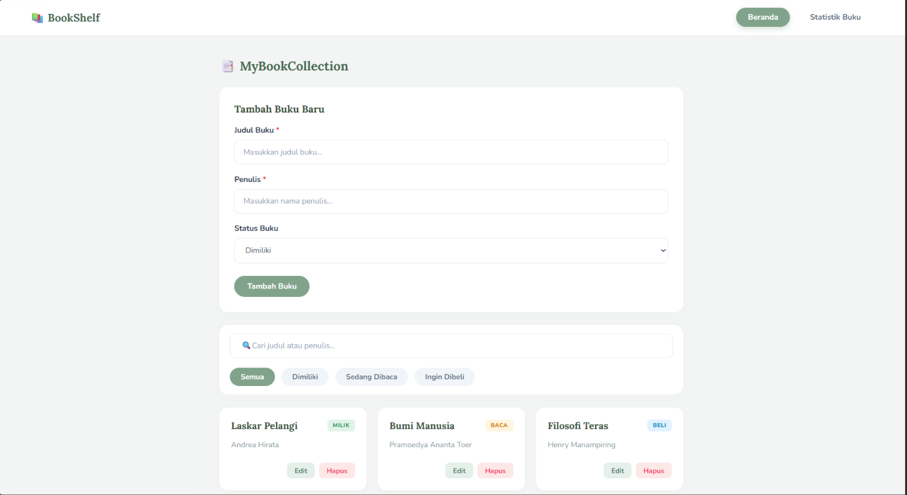
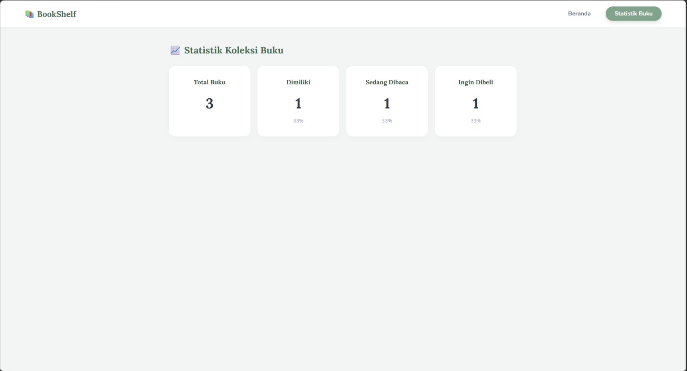
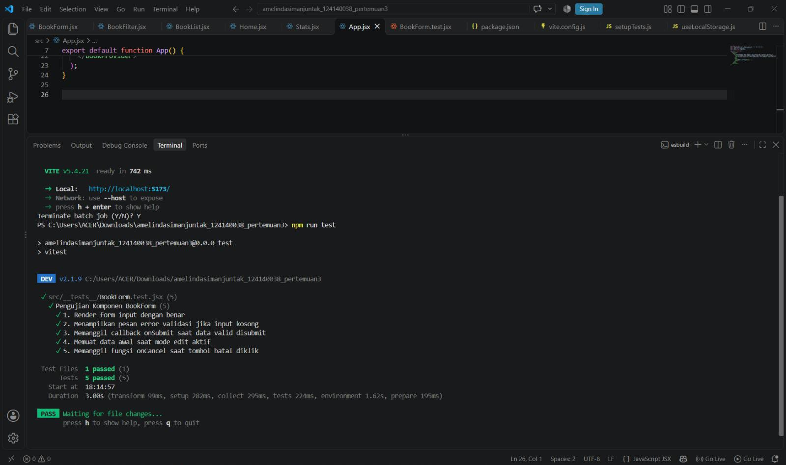

# 📚 BookShelf - Aplikasi Manajemen Buku

Aplikasi web manajemen koleksi buku berbasis **React** yang responsif, terstruktur, dan elegan. Aplikasi ini dibuat menggunakan **Vite**, **React Router**, **Context API**, serta kustomisasi **CSS (Lora & Nunito Fonts)** lengkap dengan animasi *float/lift* modern.

---

## Deskripsi Aplikasi

**BookShelf** dirancang untuk membantu pengguna mengelola daftar buku bacaan secara praktis dan terorganisir. Pengguna dapat:
- Menambahkan buku baru beserta judul, penulis, dan statusnya.
- Mengubah (*edit*) dan menghapus (*delete*) data buku.
- Memfilter daftar buku berdasarkan status (`Semua`, `Dimiliki`, `Sedang Dibaca`, `Ingin Dibeli`).
- Mencari buku secara *real-time* berdasarkan judul atau nama penulis.
- Melihat ringkasan kuantitatif dan persentase koleksi pada halaman **Statistik Buku**.

---

## Fitur React yang Digunakan

1. **Functional Components & JSX**: Membagi UI menjadi komponen-komponen kecil yang modular (`BookForm`, `BookList`, `BookFilter`, `Navbar`, dll).
2. **React Hooks**:
   - `useState`: Mengelola state lokal pada komponen form, filter, pencarian, dan edisi buku.
   - `useEffect`: Menangani sinkronisasi otomatis data dan efek samping.
   - `useContext`: Mengakses data global dari `BookContext` tanpa *prop drilling*.
3. **Custom Hook (`useLocalStorage`)**: Menyimpan data buku ke `localStorage` browser secara otomatis agar data tidak hilang saat halaman di-*refresh*, lengkap dengan inisialisasi data otomatis (*initial books data*).
4. **Context API (`BookContext`)**: Pusat pengelolaan state global (*global state management*) untuk data buku, filter, dan fitur pencarian.
5. **React Router (`BrowserRouter`, `Routes`, `Route`, `NavLink`)**: Navigasi halaman ganda antara halaman Utama (**Beranda**) dan halaman **Statistik Buku** tanpa *reload* halaman (*Single Page Application*).
6. **PropTypes**: Validasi tipe data pada *props* setiap komponen untuk mencegah kesalahan runtime dan menjaga keandalan kode.

---

## Instruksi Instalasi & Cara Menjalankan di VS Code

Ikuti langkah-langkah berikut untuk menjalankan project ini di komputer lokal menggunakan **VS Code**:

### 1. Buka Project di VS Code
- Buka aplikasi **Visual Studio Code**.
- Klik `File` -> `Open Folder...`, lalu pilih folder project ini: `amelindasimanjuntak_124140038_pertemuan3`.

### 2. Buka Terminal VS Code
- Tekan `Ctrl + ~` (atau klik menu `Terminal` -> `New Terminal` di VS Code).

### 3. Instalasi Dependencies
Jalankan perintah berikut di terminal untuk memasang seluruh paket/library yang dibutuhkan:

npm install

### 4. Menjalankan Aplikasi (Development Server)
Untuk menjalankan aplikasi dalam mode pengujian lokal, jalankan perintah:

npm run dev

Setelah berhasil, buka tautan yang muncul di terminal (biasanya `http://localhost:5173/`) pada browser Anda.

### 5. Menjalankan Pengujian / Unit Testing
Untuk memastikan seluruh fitur dan komponen lulus pengujian unit (*unit testing*):

npm run test

---

## Pengaturan Git & `.gitignore`

Project ini telah dilengkapi dengan file `.gitignore` standar untuk memastikan dependensi berat dan file konfigurasi lokal **tidak ikut terunggah** ke repositori Git.

Isi `.gitignore` memastikan folder berikut diabaikan:
- `node_modules/` *(diabaikan agar ukuran repositori tetap ringan)*
- `dist/` / `build/` *(folder hasil kompilasi)*
- `.env.local` *(konfigurasi lingkungan lokal)*

---

## 📸 Dokumentasi & Laporan Testing

### 1. Antarmuka Aplikasi (UI)

### 2. Laporan Unit Testing Terminal
