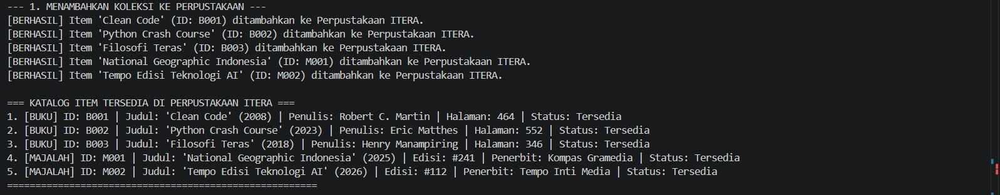
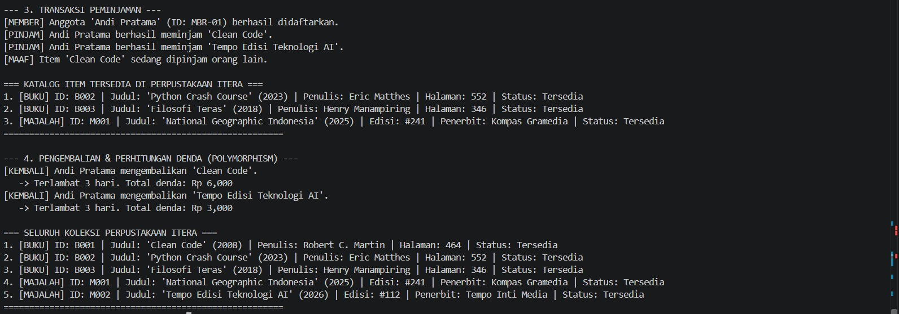
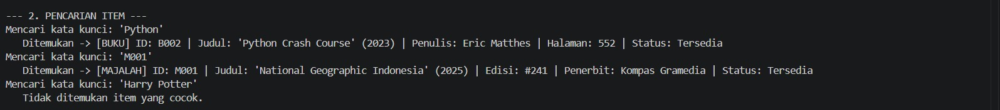

# Tugas Praktikum Pertemuan 5 - Sistem Manajemen Perpustakaan Sederhana (OOP Python)

## Identitas Mahasiswa
* **Nama Lengkap:** Amelinda Simanjuntak
* **NIM:** 124140038
* **Kelas Praktikum:** RA

---

## Deskripsi Program
Program ini merupakan simulasi sistem manajemen perpustakaan sederhana berbasis konsol (*Command Line Interface*) yang dibangun menggunakan bahasa pemrograman Python dengan pendekatan **Object-Oriented Programming (OOP)**. Sistem ini mendukung penambahan koleksi buku dan majalah, menampilkan daftar koleksi yang tersedia, pencarian koleksi berdasarkan ID atau judul, serta transaksi peminjaman dan pengembalian oleh anggota perpustakaan.

### Penerapan 4 Pilar OOP dalam Program:
1. **Class & Object:**
   Program dipecah menjadi beberapa class sesuai tanggung jawabnya (`LibraryItem`, `Book`, `Magazine`, `Member`, dan `Library`) yang diinstansiasi menjadi objek pada `main.py`.
2. **Abstraction & Inheritance:**
   `LibraryItem` didefinisikan sebagai *Abstract Base Class* (`ABC`) yang memiliki *abstract method* `get_detail()` dan `calculate_fine()`. Class `Book` dan `Magazine` mewarisi (*inheritance*) atribut dasar dari `LibraryItem` serta wajib mengimplementasikan method abstrak tersebut.
3. **Encapsulation:**
   Data penting dilindungi menggunakan *access modifiers*, seperti atribut *protected* (`_item_id`, `_title`) dan *private* (`__is_borrowed` pada `LibraryItem` serta `__koleksi` pada `Library`). Akses dan perubahan data dikontrol melalui `@property` dan `@setter` decorator.
4. **Polymorphism:**
   Method `get_detail()` dan `calculate_fine()` dipanggil dengan antarmuka yang sama pada objek `Book` maupun `Magazine`, namun menghasilkan perilaku berbeda sesuai jenis objeknya (tarif denda buku Rp 2.000/hari, sedangkan majalah Rp 1.000/hari).

---

## Panduan Menjalankan Program
1. Buka terminal atau command prompt.
2. Masuk ke direktori `tugas_perpustakaan`:
   ```bash
   cd tugas_perpustakaan

### 1. Fitur Penambahan Koleksi


### 2. Fitur Penampilan Katalog


### 3. Fitur Pencarian Item
